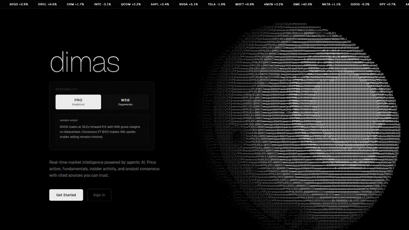
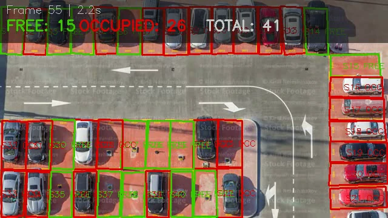
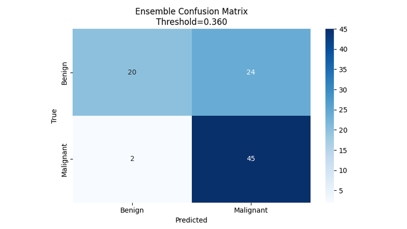
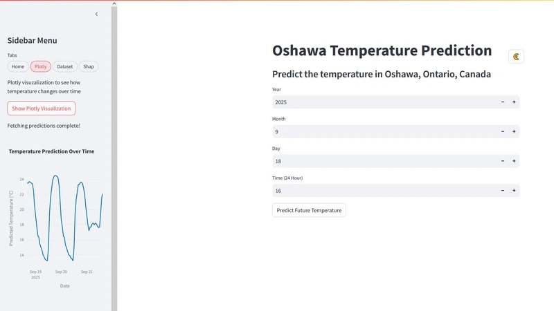

# Dragos Sorescu

I'm an aspiring machine learning engineer in Toronto and a research assistant at Durham College's AI Hub.

## Selected projects

<table>
  <tr>
    <td width="50%" valign="top">
      
      
<strong><a href="https://github.com/Sxres/FunnyMarketNewsLetter">dimas ↗</a></strong> 
      Ask about a stock ticker and Claude pulls live prices, market news, and insider trades into the chat.

    </td>
    <td width="50%" valign="top">
      
      
<strong><a href="https://github.com/Sxres/LotWatch">LotWatch ↗</a></strong> 
      An OpenCV pipeline watches a parking lot and counts the open spaces in each frame.

    </td>
  </tr>
  <tr>
    <td width="50%" valign="top">
      
      
<strong><a href="https://github.com/Sxres/SkinCancerImageClassificationResearch">Vision Transformer Research ↗</a></strong> 
      We compared DINOv2, Swin, and ResNet on skin lesion images using five-fold cross-validation.

    </td>
    <td width="50%" valign="top">
      
      
<strong><a href="https://github.com/Sxres/temperature_predictor_app">Oshawa Temperature Prediction ↗</a></strong> 
      A Streamlit app predicts hourly temperatures with an XGBoost model trained on local weather station records.

    </td>
  </tr>
</table>

## Tech stack

### Languages

### ML & Data

### LLMs & Evaluation

### Web & Backend

### Cloud

### Development & Testing

---

  <a href="https://sxres.dev/"> <strong>Portfolio · sxres.dev ↗</strong></a>
  &nbsp;&nbsp;·&nbsp;&nbsp;
  <a href="https://www.linkedin.com/in/dragos-sorescu/"> <strong>LinkedIn ↗</strong></a>

